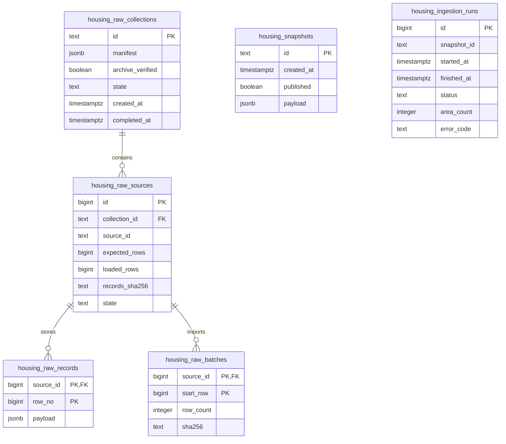

# 서울사이 ERD

현재 저장소의 Supabase migration에 정의된 **6개 애플리케이션 테이블** 기준입니다. 원격 Supabase에 적용 완료된 DB를 역설계한 자료는 아닙니다.

## 테이블 역할

| 테이블 | 역할 | 접근 |
|---|---|---|
| housing_raw_collections | 수집 버전, 파일 목록·해시, 전체 적재 상태 | 서버 전용 |
| housing_raw_sources | 수집 버전별 API 원천, 기대·적재 건수 | 서버 전용 |
| housing_raw_records | 전월세·안전시설·교통·의료 등 전체 원천 레코드 | 서버 전용 |
| housing_raw_batches | 분할 적재 이력, 중복 방지·재시도 검증 | 서버 전용 |
| housing_snapshots | 화면에서 사용하는 지역별 집계·점수·도보 경로 JSON | published=true 행만 공개 읽기 |
| housing_ingestion_runs | 집계 스냅샷 수집 작업 이력 | 서버 전용 |

## 실제 관계와 제약

- 수집 버전 1개에 원천 0개 이상, 원천 1개에 레코드/배치 0개 이상이 속합니다. 적재 중에는 자식이 없을 수 있습니다.
- `housing_raw_sources`는 `(collection_id, source_id)` 조합이 UNIQUE입니다. 두 컬럼 각각이 UNIQUE인 것은 아닙니다.
- `housing_raw_records`의 복합 PK는 `(source_id, row_no)`입니다.
- `housing_raw_batches`의 복합 PK는 `(source_id, start_row)`입니다.
- 자식 테이블의 `source_id bigint`는 `housing_raw_sources.id`를 참조합니다. `housing_raw_sources.source_id text`는 API 이름을 저장하는 별도 컬럼입니다.
- `housing_ingestion_runs.snapshot_id`는 현재 nullable 일반 텍스트이며 **외래키가 아닙니다**. 따라서 ERD에 참조선을 그리지 않았습니다. 현재 자동 수집 배치에서 이 테이블에 이력을 적재하는 기능도 연결되지 않았습니다.
- 공개 스냅샷과 원천 컬렉션 사이에는 현재 FK가 없습니다. 원천 → 집계 → 스냅샷은 처리 흐름이며 DB 참조 관계는 아닙니다.
- raw의 state는 loading/complete, ingestion의 status는 running/success/failed입니다.
- nullable 컬럼은 collections.completed_at 및 ingestion의 snapshot_id, finished_at, area_count, error_code입니다. 나머지 표시 컬럼은 NOT NULL입니다.

## JSON과 파일에 저장되는 서비스 데이터

현재 MVP는 동네·월세·전세·시설·점수를 각각 독립 테이블로 정규화하지 않았습니다.

`housing_snapshots.payload`에는 스냅샷 메타정보, 출처, 경고와 `areas[]`가 들어갑니다. 각 지역은 다음 데이터를 포함합니다.

- 법정동 코드·이름·자치구·대표 좌표·경계
- 안전·교통·의료 점수, 지표와 출처별 근거
- `rentalGroups[]`: 보증금·월세 조합별 월세 거래 건수
- `jeonseGroups[]`: 전세 보증금별 거래 건수
- `walking`: 역 출입구 인근 보행 경로·거리·추정 시간

`housing_raw_records.payload`에는 원천별 컬럼을 그대로 보관합니다. 보증금·월세·시설 위치 등을 별도 공통 컬럼으로 바꾼 테이블은 아닙니다.

원본 압축 파일은 Supabase Storage의 비공개 `housing-raw` 버킷에 `<collection-id>/archive/...` 경로로 저장하도록 준비했습니다. 연결 정보는 manifest에 있으며, Storage 내부 테이블과 애플리케이션 테이블 간 FK는 만들지 않았습니다. 장소 이름 검색 목록은 현재 로컬 정적 JSON입니다.

## 기준 파일

- [기본 스키마](../supabase/migrations/202611140001_housing_mvp.sql)
- [원천 스키마](../supabase/migrations/202611160003_full_raw.sql)
- [스냅샷 타입](../src/lib/types.ts)
- [Mermaid 원본](erd.mmd)

